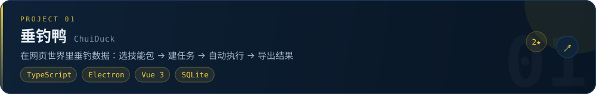
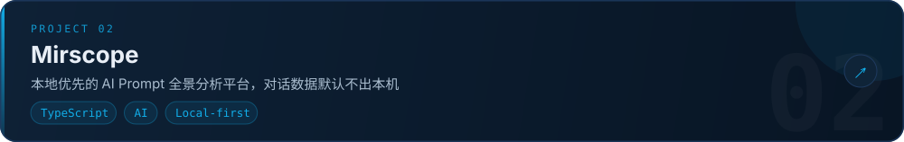
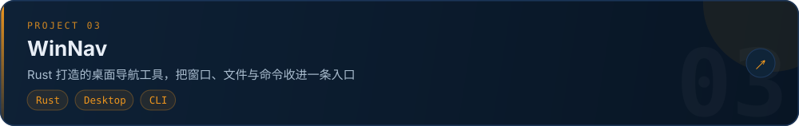
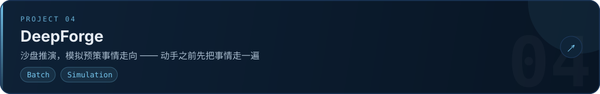
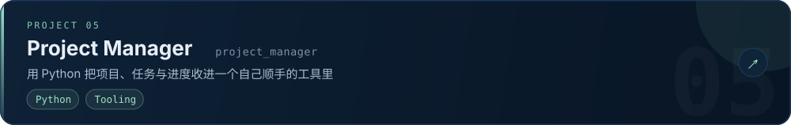
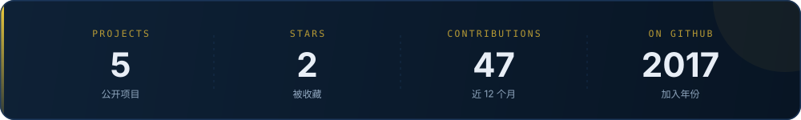
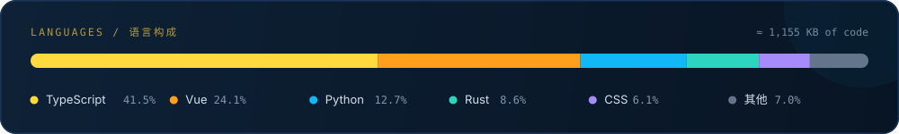

<!-- ============================================================
     宋朝阳 · GitHub 个人主页
     素材由 tools/gen_assets.py 生成，数据卡由 tools/gen_stats.py 每日刷新
     ============================================================ -->

  

 

  
  
  

  

## 关于我

白天在数据里找答案：写 SQL、搭指标，把一堆表格变成能看的结论。
晚上在编辑器里找乐子：把脑子里的小工具，真的做成能用的软件。

- 🔭 **正在打磨** [垂钓鸭 ChuiDuck](https://mrsongzhaoyang.github.io/chuiduck/) —— Chrome 插件 + Electron，让不写代码的人也能把网页重复劳动自动化
- 🧠 **最近在折腾** [Mirscope](https://github.com/mrsongzhaoyang/Mirscope) —— 本地优先的 AI Prompt 分析台，对话数据默认不出本机
- 🦀 **顺手之作** [WinNav](https://github.com/mrsongzhaoyang/WinNav) —— 用 Rust 写一个桌面导航工具，把窗口、文件与命令收进一条入口
- 📄 **完整履历** —— 项目、证书与经历都整理在 [szy-resume.top](https://www.szy-resume.top/)

## 技术栈

  

  
  
  
  
  
  

## 代表作品

  

  

  

  

  

## 数据面板

  

  

数据卡由 [GitHub Actions](.github/workflows/stats.yml) 每天自动从公开接口拉数据重绘；页面里的图片全部走仓库内相对路径，不依赖第三方图床。

## 找到我

  
  
  

 
  “你若安好，那还得了。” · 用 ☕ 和 🦆 手工打磨

<!--
维护说明
- 改文案 / 项目卡片：编辑 tools/gen_assets.py 里的 PROJECTS，然后 `python3 tools/gen_assets.py`
- 数据卡：本地跑 `python3 tools/gen_stats.py`，或等每天 03:17 UTC 的 workflow 自动刷新
- 图片全部走相对路径（assets/…），不依赖任何第三方图床，换主题/换仓库都不会裂图
-->
